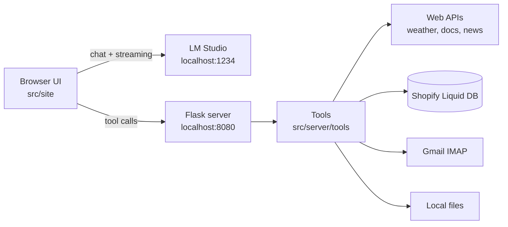

# AI Central

A local AI chatbot that runs entirely on your own machine. It talks to a model
served by [LM Studio](https://lmstudio.ai/), and it can actually *do* things:
read and write files, search your Gmail, look up documentation, check the
weather, and more.

No cloud account, no API keys, no data leaving your computer (except the
websites the tools fetch from).

---

## What you need before you start

| Requirement | Why |
| --- | --- |
| **Python 3.14+** | The backend is written for 3.14 |
| **[uv](https://docs.astral.sh/uv/)** | Installs dependencies and runs the app |
| **[LM Studio](https://lmstudio.ai/)** | Serves the AI model locally |
| A model downloaded in LM Studio | Something with tool-calling support works best |

Check your versions:

```bash
python3 --version   # should print 3.14 or newer
uv --version
```

---

## Step 1 — Start LM Studio's local server

1. Open LM Studio.
2. Download and load a model (the "Chat" tab).
3. Go to the **Developer** / **Local Server** tab and press **Start Server**.
4. Confirm the server address is `http://localhost:1234`.

Two settings matter a lot:

- **Enable CORS** - turn this on. Without it the browser cannot talk to LM Studio.
- **Disable "Just-in-Time Model Loading"** - otherwise AI Central cannot tell
  which model is loaded and may pick the wrong one.

> If the page shows a CORS or "cannot connect" alert later, it is almost always
> one of these two settings.

---

## Step 2 — Install the project

From the repository root:

```bash
cd src
uv sync
```

`uv sync` creates a virtual environment in `src/.venv` and installs Flask,
`requests`, and `cryptography`.

---

## Step 3 — Run it

```bash
cd src
uv run python server.py
```

You should see the server starting up without errors.

Your browser opens automatically. If it does not, go to
**http://localhost:8080**.

Stop the server with `Ctrl+C`.

---

## Step 4 — Try it out

Type a message and press **Enter** (or click **Send**). Some things to try:

- `What's the weather in London?`
- `Search Wikipedia for the Voyager probes`
- `Write a haiku to ~/Desktop/haiku.txt`
- `Look up the Python docs for asyncio.gather`
- `What does the Shopify Liquid "money" filter do?`

When a tool needs to touch your computer (like writing a file), a permission
dialog appears. You can **Deny**, **Allow Once**, or **Always Allow**.

---

## Optional — Connect Gmail

AI Central can search, read, and send email through Gmail over IMAP.

1. In Gmail, enable **IMAP** (Settings → Forwarding and POP/IMAP).
2. Create an **App Password** at
   <https://myaccount.google.com/apppasswords>.
3. In AI Central, open **Settings** (gear icon) → **Services** → **Gmail** →
   **Connect**.
4. Enter your Gmail address, the 16-character app password, and choose a
   **master password**.

Your credentials are encrypted with your master password and stored in
`src/tool_data/gmail_credentials.enc` (which is git-ignored). On the next start
you will be asked for the master password to unlock Gmail.

---

## How it fits together



- **`src/site/`** — the frontend. Plain HTML/CSS/JS, no build step.
  - `index.html` loads every tool script, then `index.js`.
  - `js/tools-core.js` holds the tool registry and permission system.
  - `js/tools/tool-*.js` each register one tool with `registerTool({...})`.
- **`src/server/`** — the Flask backend.
  - `routes.py` serves the site, proxies LM Studio, and runs tools.
  - `tools/` contains one class per tool, all registered in `tools/__init__.py`.
  - `helpers.py` has shared HTTP, HTML-cleaning, and path helpers.
  - `db/shopify_liquid.db` is a searchable SQLite copy of the Liquid docs (June 2026).

The browser talks to LM Studio directly for chat, and to Flask for anything
that needs the local machine or a server-side secret.

---

## Adding your own tool

A tool has two halves: a Python executor and a frontend registration.

**1. Backend** — create `src/server/tools/my_tool.py`:

```python
from .base import BaseTool


class MyTool(BaseTool):
    name = "my_tool"
    description = "Does something useful."

    def execute(self, args):
        return "hello from my tool"
```

Register it in `src/server/tools/__init__.py` by adding it to the list passed to
`TOOL_EXECUTORS`.

**2. Frontend** — create `src/site/js/tools/tool-my_tool.js`:

```javascript
registerTool({
  name: "my_tool",
  description: "Does something useful.",
  icon: "\u2699",
  parameters: {
    type: "object",
    properties: {
      query: { type: "string", description: "What to look up" },
    },
    required: ["query"],
  },
  execute: async function (args) {
    return await callFlaskTool("my_tool", args);
  },
});
```

Then add `<script src="js/tools/tool-my_tool.js" defer></script>` to
`src/site/index.html` next to the other tool scripts.

Finally, mention the tool in the system prompt in `src/site/js/index.js`
(`buildSystemPrompt`) so the model knows it exists.

---

## Troubleshooting

| Symptom | Fix |
| --- | --- |
| "Cannot connect to LM Studio" | Start the local server in LM Studio |
| "CORS error" | Enable CORS in LM Studio's Local Server settings |
| "No model loaded" | Load a model in LM Studio |
| "Please disable Just-in-Time Model Loading" | Turn that option off in LM Studio |
| Port 8080 already in use | Stop the other process, or change `port` in `src/server/__init__.py` |
| Gmail says "locked" | Open Settings and unlock with your master password |

---

## Useful commands

```bash
cd src
uv sync                 # install / update dependencies
uv run python server.py # start the app
uv run ruff check .     # lint the Python code
```
